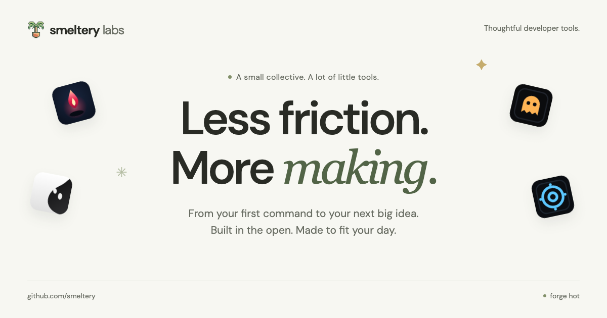

# smeltery/website

[](https://github.com/smeltery/website/actions/workflows/ci.yml)
[](https://github.com/smeltery/website/actions/workflows/release.yml)
[](LICENSE)
[](https://astro.build)
[](https://bun.sh)
[](tsconfig.json)
[](https://flox.dev)
[](.pre-commit-config.yaml)
[](docs/README.md)
[](docs/architecture/overview.md)

The Smeltery Labs landing page: a static Astro site inspired by the
quiet, playful design of `smeltery/convrt` and `smeltery/loft`. It ships zero framework JavaScript, self-hosts
its fonts, and sends no telemetry.



```console
$ flox activate
$ bun run dev        # http://localhost:4321
$ bun run verify     # everything CI checks
```

## What is here

- `src/` holds the page, one Astro component per section, and the design
  tokens.
- `src/data/site.ts` holds every piece of copy, link, and tool listing.
- `public/` holds the mark, tool icons, optimized 3D renders, and the OG image.
- `scripts/` holds the LOC budget and Mermaid checks.

## Documentation

Start at [docs/README.md](docs/README.md). Highlights:

- [Setup](docs/getting-started/setup.md) with Flox and Bun
- [Architecture](docs/architecture/overview.md) and the
  [design system](docs/architecture/design-system.md)
- [Editing content](docs/guides/editing-content.md)
- [CI and hooks](docs/operations/ci.md) and [releasing](docs/operations/releasing.md)

## License

[PolyForm Shield 1.0.0](LICENSE)
