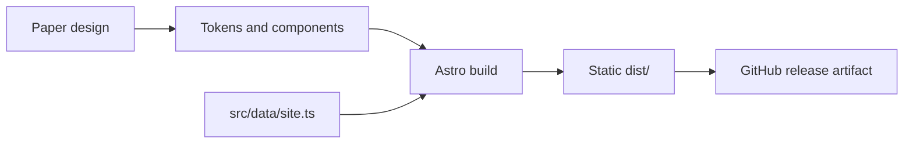

# Documentation

Guides for working on the Smeltery Labs website.

| Topic | Read this when you want to |
| --- | --- |
| [Setup](getting-started/setup.md) | Get a working dev environment in one command |
| [Architecture](architecture/overview.md) | Understand how the page is composed and built |
| [Design system](architecture/design-system.md) | Match Paper tokens, breakpoints, and hover states |
| [Editing content](guides/editing-content.md) | Change copy, add a tool, or swap an asset |
| [CI and hooks](operations/ci.md) | Know what runs on commit, push, and pull request |
| [Releasing](operations/releasing.md) | Understand how versions and artifacts get cut |

