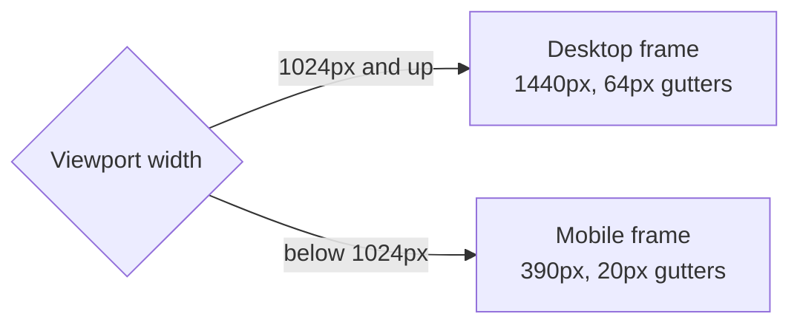

# Design system

The source of truth is the `smeltery/website` Paper file. CSS custom properties
in `src/styles/global.css` copy its tokens one-to-one.

## Tokens

| Token | Value | Used for |
| --- | --- | --- |
| `--color-neutral-50` | `#FFFFFF` | Page ground |
| `--color-neutral-100` | `#F0F0E0` | Principles band |
| `--color-neutral-500` | `#666666` | Muted labels |
| `--color-neutral-900` | `#0A0A0A` | Ink, terminal, footer |
| `--color-primary` | `#FFD100` | Signage yellow, hovers, CTA band |
| `--color-secondary` | `#1A3D28` | Eyebrows and categories |
| `--color-accent` | `#D07050` | Principle numbers, terminal dot |
| `--font-display` | Syne 800 | Headlines and wordmark |
| `--font-body` | DM Sans | Body copy and nav |
| `--font-mono` | IBM Plex Mono | Commands, terminal, metadata |

## Breakpoints

Copy that differs between frames, such as the shorter terminal labels and
tool blurbs, lives side by side in `src/data/site.ts`. The `.desk-only` and
`.mobile-only` utilities pick one per breakpoint.

## Hover states

These come from the Paper "Hover States" page.

| Element | Hover |
| --- | --- |
| Nav link | Yellow fill, weight 600 |
| `npx smeltery` button | Yellow fill, ink text |
| Tool row | Yellow fill, ink rules, 16px inset, larger arrow |
| Terminal status row | Dark amber fill, white label |
| Mobile menu item | Yellow fill, 12px inset |

## 3D renders

`public/3d/*.webp` are the Paper renders exported at 2x their display size.
Re-export at the same sizes when replacing them to keep the page light.
