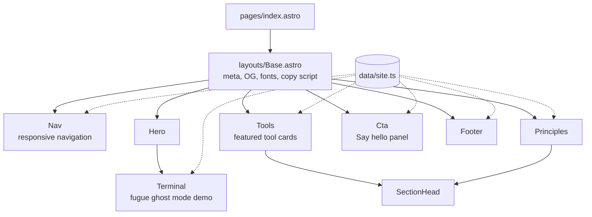
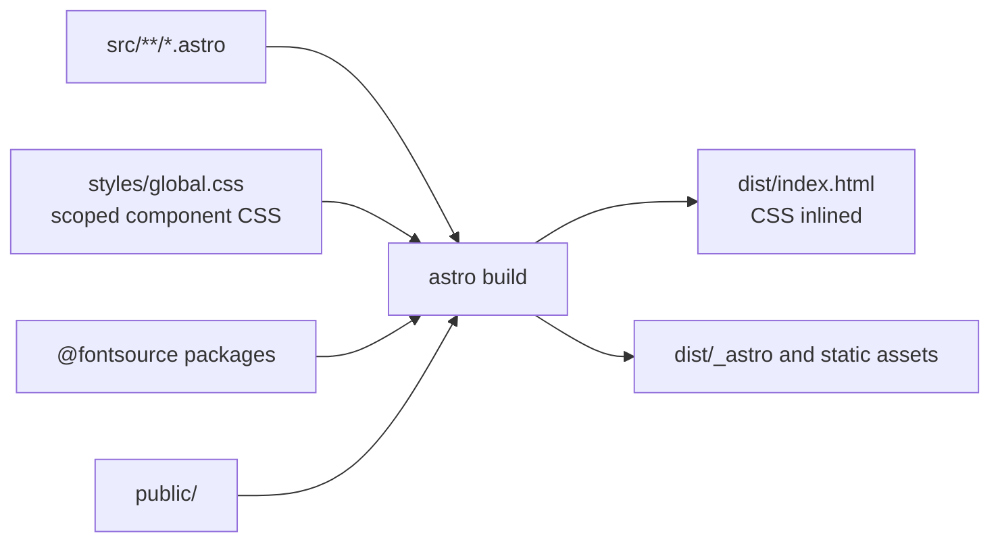

# Architecture

The site is one static page. Astro renders it at build time, inlines the CSS,
and emits a single `index.html` plus assets. A tiny inline script handles the
copy-to-clipboard command button. Decorative motion uses CSS and respects
reduced-motion preferences.

## Page composition

Each component owns one section of the page.

## Build pipeline

## Choices

- **Astro** renders components to HTML with no runtime, which keeps the
  page fast and lightweight.
- **Scoped CSS per component** keeps each section's styles next to its markup.
  Shared tokens and utilities live in `src/styles/global.css`.
- **Self-hosted fonts** through Fontsource avoid third-party requests,
  matching the "privacy by default" principle.
- **Responsive layouts** use 760px, 640px, and 480px breakpoints to adapt
  the workbench, navigation, tool grid, and footer.
