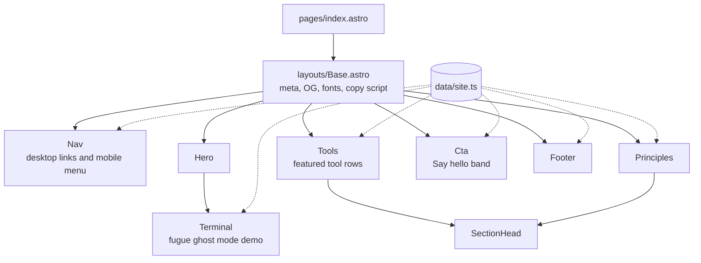
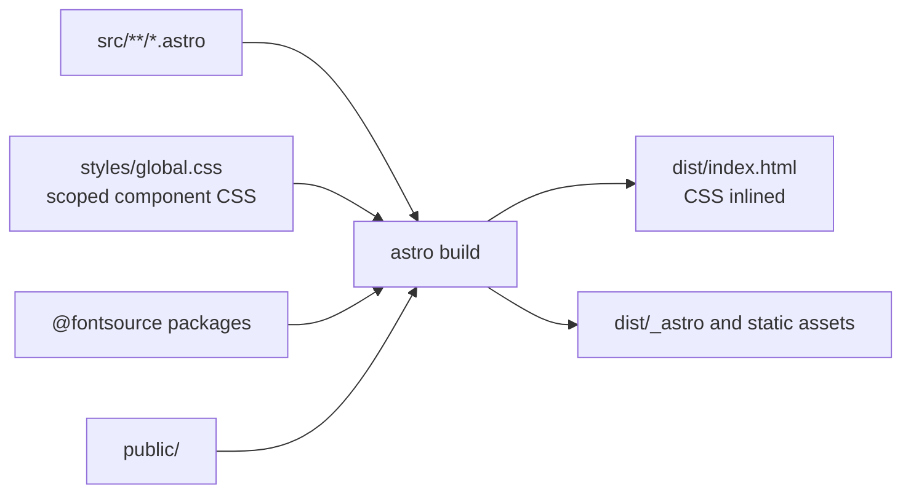

# Architecture

The site is one static page. Astro renders it at build time, inlines the CSS,
and emits a single `index.html` plus assets. Two tiny inline scripts handle the
mobile menu and the copy-to-clipboard command button; nothing else runs in the
browser.

## Page composition

Each component maps to one frame in the Paper file.

## Build pipeline

## Choices

- **Astro** renders components to HTML with no runtime, which keeps the
  page close to the static Paper frames.
- **Scoped CSS per component** keeps each frame's styles next to its markup.
  Shared tokens and utilities live in `src/styles/global.css`.
- **Self-hosted fonts** through Fontsource avoid third-party requests,
  matching the "privacy by default" principle.
- **One breakpoint** at 1024px switches between the 1440px desktop frame and
  the 390px mobile frame.
