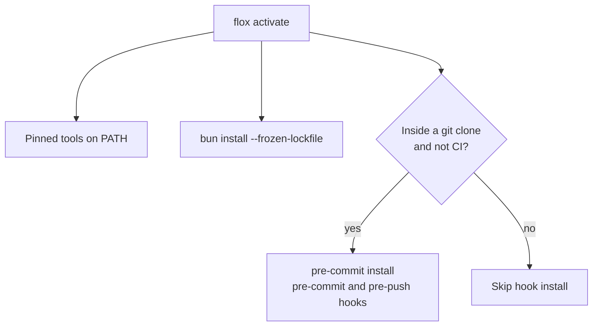

# Setup

Flox provides the whole toolchain: Bun, Node, pre-commit, actionlint,
shellcheck, lychee, gh, and jq. CI runs inside the same environment, so a
green local run means a green CI run.

## First run

```console
$ git clone git@github.com:smeltery/website.git
$ cd website
$ flox activate
```

Activation does three things:



It also sets `ASTRO_TELEMETRY_DISABLED=1` so local builds stay private.

## Everyday commands

| Command | What it does |
| --- | --- |
| `bun run dev` | Dev server with hot reload on port 4321 |
| `flox services start` | Same dev server, managed as a Flox service |
| `bun run build` | Static build into `dist/` |
| `bun run preview` | Serve the built `dist/` |
| `bun run check` | Astro and TypeScript diagnostics |
| `bun test` | Smoke tests against the built page |
| `bun run format` | Prettier write |
| `bun run verify` | Format check, types, Markdown lint, build, and tests |

## Without Flox

Install Bun 1.3+ and Node 22, then run `bun install`. Hooks need
`pre-commit`, `actionlint`, and `lychee` on your PATH.
