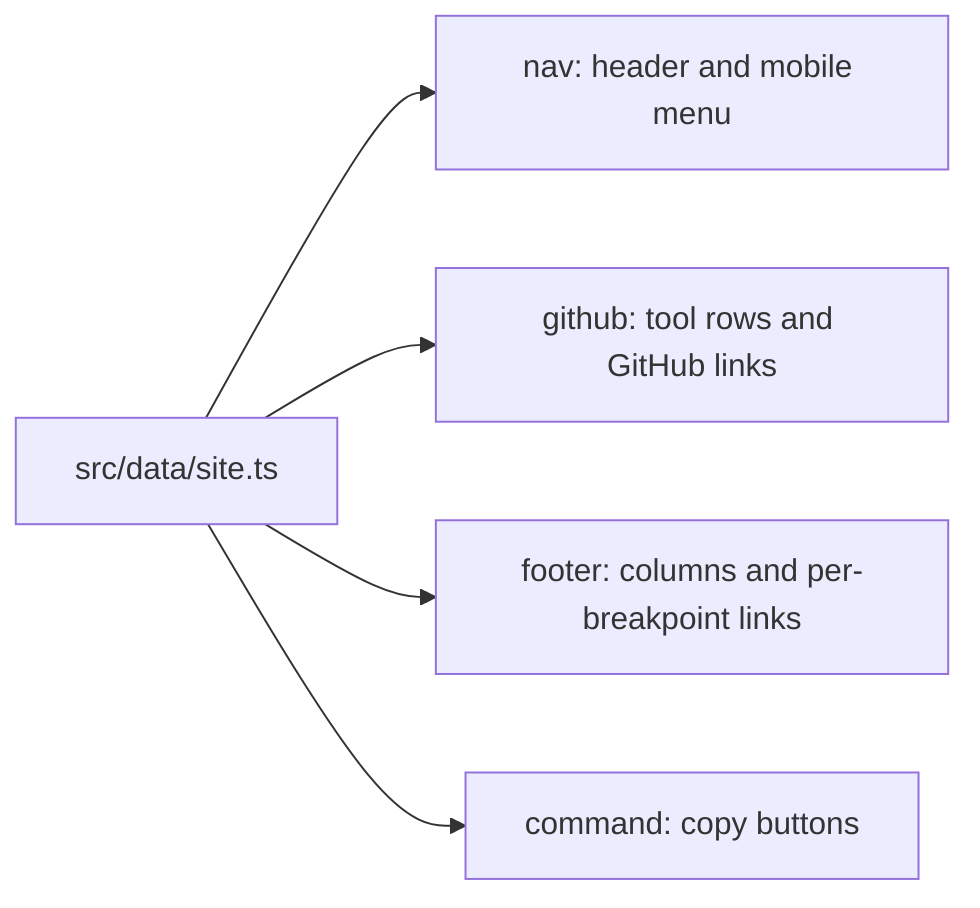

# Editing content

All copy and links live in `src/data/site.ts`. Components only render it.

## Add a featured tool

1. Add an icon SVG to `public/tools/` (optional; rows without one render
   flush left, like `set-me-up`).
2. Append an entry to `tools`:

   ```ts
   {
     name: "airlock",            // also the GitHub repo name
     icon: "/tools/airlock.svg",
     category: "Security",
     platform: "local",
     blurb: "Desktop sentence.",
     short: "Shorter mobile sentence.",
   }
   ```

3. Run `bun run dev` and check both breakpoints.

The "Showing N of 90+" counter updates itself.

## Change where links point



Footer columns and links accept `only: "desktop"` or `only: "mobile"` to
match the two Paper frames.

## Site URL and OG image

Set `SITE_URL` at build time to the production origin so canonical and OG
URLs are absolute:

```console
$ SITE_URL=https://example.com bun run build
```

Replace `public/og.png` with a fresh 1200x630 export from the Paper
"Social" page.
