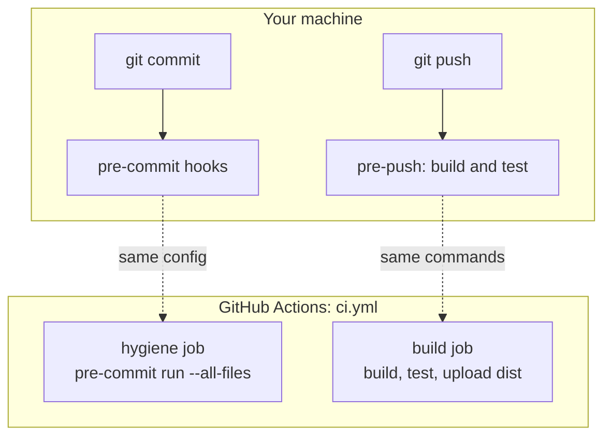

# CI and hooks

Pre-commit hooks and CI run the same checks, from the same Flox environment.
If the hooks pass locally, CI passes. Each local hook runs through
`scripts/flox-run.sh`, which enters Flox when it is not already active, so
commits from an editor or a plain shell use the same tool versions.

## Checks

| Hook | Tool | Catches |
| --- | --- | --- |
| Whitespace, EOF, merge markers, YAML, large files | pre-commit-hooks | Hygiene drift |
| `prettier` | Prettier with the Astro plugin | Formatting |
| `astro-check` | `astro check` (strictest TS) | Type and template errors |
| `markdownlint` | markdownlint-cli2 | Markdown style |
| `mermaid` | `scripts/check-mermaid.ts` | Diagrams that fail to render |
| `links` | lychee, offline | Broken relative links and anchors |
| `budgets` | `scripts/check-budgets.ts` | Files over 250 lines, folders over 10 files |
| `actionlint` | actionlint with shellcheck | Workflow mistakes |
| `shellcheck` | shellcheck | Shell script bugs |
| `build-test` (pre-push) | `bun run build && bun test` | Broken build or page |

## LOC budgets

`scripts/budgets.json` sets the default limits. Add an entry under `files` or
`directories` only with a reason, and ratchet limits down after refactors.

## Mermaid validation

The Mermaid check renders each diagram in headless Chrome using the real
Mermaid renderer. On first run it downloads `chrome-headless-shell` into
`~/.cache/smeltery-website`; set `PUPPETEER_EXECUTABLE_PATH` to reuse an
existing Chrome.
