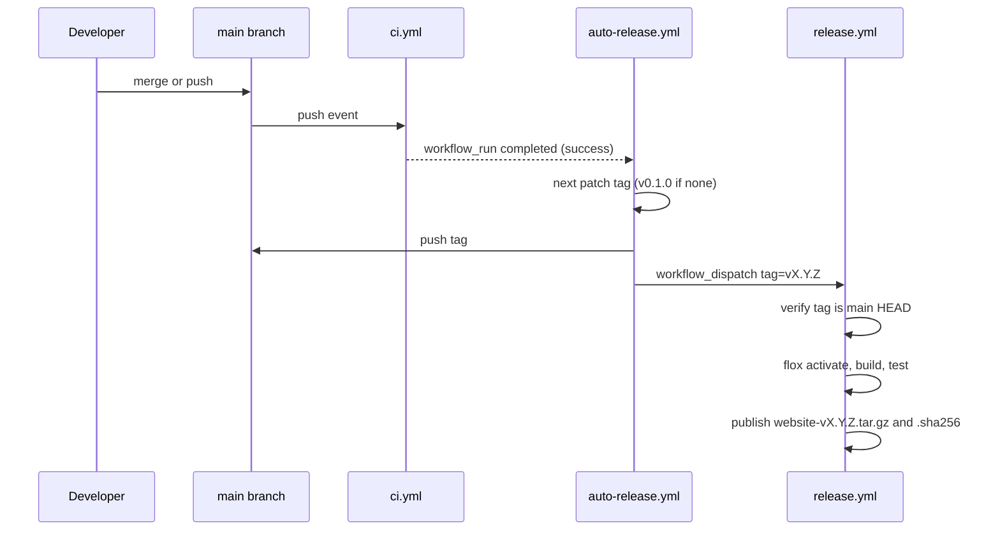

# Releasing

Releases are automatic and follow the same flow as `smeltery/hab`. Every green
CI run on `main` gets the next patch tag and a release with the built site
attached.



## Details

- A commit that already carries a release tag is skipped, so reruns are safe.
- Tags pushed with `GITHUB_TOKEN` do not trigger other workflows, so
  auto-release dispatches `release.yml` explicitly.
- For a minor or major bump, push the tag yourself, for example
  `git tag v0.2.0 && git push origin v0.2.0`. The release workflow runs on tag
  pushes too.

## Verifying an artifact

```console
$ gh release download vX.Y.Z -R smeltery/website
$ shasum -a 256 -c website-vX.Y.Z.tar.gz.sha256
```
